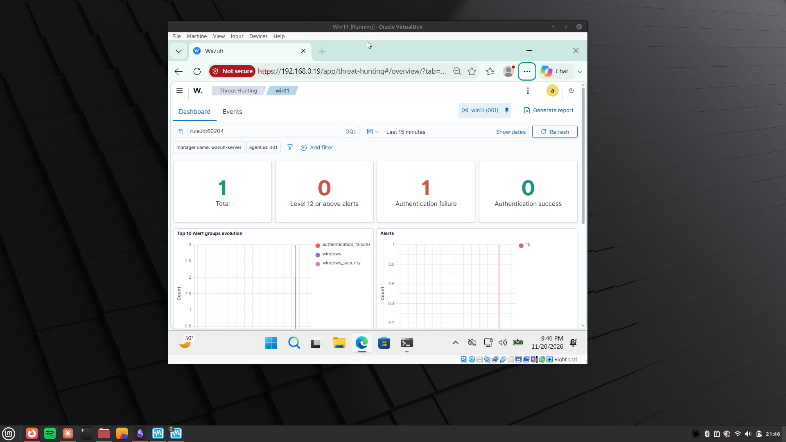

# Wazuh Home Lab: Detecting an RDP Brute-Force

**Date:** 2026-11-20
**Goal:** Stand up Wazuh, generate failed RDP logins, and detect them.

## Lab Setup
- SIEM: Wazuh 4.14.10 VM (VirtualBox, bridged networking)
- Target: Windows 11 Enterprise VM, RDP enabled, Wazuh agent installed
- Attacker: Linux host (ThinkPad T480s) running xfreerdp

## Attack
Fired 10 failed RDP logins from the Linux host:

    for i in $(seq 10); do xfreerdp /v:192.168.0.221 /u:fakeuser /p:wrong /cert:ignore +auth-only; done

## Detection
Searched the Wazuh dashboard for rule.id:60204 over the last 15 minutes.

- Rule 60204: multiple Windows logon failures from the same source
- Result: 1 alert, flagging the burst of authentication failures

## What I Learned
- How Wazuh agents forward Windows Security logs to the manager
- How correlation rules turn many 4625 events into one higher-signal alert
- Why a SOC analyst tunes on rules like this to catch brute-force early

## Next Steps
- Add a Suricata or Sysmon lab for network and process visibility
- Simulate a successful login after the failures and alert on it

